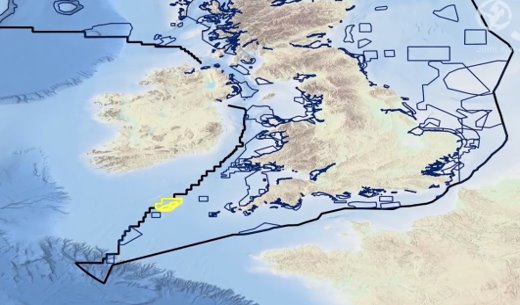

# Paidiverpy workshop

Learn to open, inspect, and preprocess marine images in Jupyter. Begin with a short seafloor example, then compare processing choices for seafloor and plankton images. The last exercise adds two ways to run an algorithm.

## Set up your notebook

Choose the [NOC Data Science Platform](DSP.md) or [JASMIN](jasmin.md) instructions for your account. Tutorials 1–3 use the platform's shared image folders by default. Tutorial 4 uses five JNCC images and can download them directly from the source collection. Select the **PAIDIVER** Python kernel and run cells in order with **Shift+Enter**. A kernel is the Python session that remembers variables created by earlier cells.

The workshop uses Paidiverpy 0.4.1 with Library Layer support. Check the environment on the platform setup page before starting. If a notebook cannot find a YAML or metadata file, check that Jupyter is running in the workshop repository or its `tutorials` folder.

## Datasets

### Greater Haig Fras seafloor imagery

Tutorials 1 and 2 use images from the 2012 Greater Haig Fras survey in the central Celtic Sea. The autonomous underwater vehicle Autosub6000 photographed the seabed along transects. The workshop uses a resized copy to reduce memory use. The accompanying iFDO metadata records filenames, timestamps, positions, and image area.

In the first tutorial, use a handful of images to learn the interface. In the second, filter by the timestamps in the metadata and explore how preprocessing affects the visibility of seabed features.

Sources: [BODC survey imagery](https://doi.org/10.5285/090239b1-b7dd-1030-e063-6c86abc-0e183), [Benoist et al. 2023, companion mosaicked image tiles](https://doi.org/10.5285/093edbc7-3552-3d35-e063-6c86abc099d5).

### DY157 plankton imagery

Tutorial 3 uses pelagic plankton images collected in 2023 during the DY157 RRS Discovery cruise. A red camera frame was lowered vertically by winch to image organisms in the water column. The workshop metadata is supplied as a CSV, a table with one record per image. The exercises focus on uneven illumination and low contrast, both of which can make faint structures difficult to see.

Sources: [DY157 cruise inventory](https://www.bodc.ac.uk/resources/inventories/cruise_inventory/report/18120/), [Paidiverpy example datasets](https://paidiverpy.readthedocs.io/en/latest/example_data.html).

### JNCC East of Haig Fras seabed imagery (`benthic_ifdo2`)

Tutorial 4 uses five JPEGs from the 2013 CEND0513 survey by the Joint Nature Conservation Committee (JNCC) and Cefas aboard the RV Cefas Endeavour. This is a separate survey from the 2012 Greater Haig Fras imagery. The full Paidiverpy sample is named `benthic_ifdo2` and will be available as `benthic_ifdo2.zip` alongside the other sample archives once published. The workshop includes iFDO metadata for the five exercise files. The notebook reuses images from the local cache or downloads those five images directly from the source collection.

Source metadata credits JNCC and Cefas and records the Open Government Licence v3.0. See the [source image collection](https://jncc.resourcespace.com/pages/search.php?search=%21collection99) and [survey report](https://data.jncc.gov.uk/data/a74dc2aa-e8e9-4f23-81a2-287eefa7a47d/JNCC-CEFAS-28-FINAL-WEB.pdf).

## Tutorials

| Tutorial | What you will do |
| --- | --- |
| [1. Introduction](https://github.com/paidiver/paidiver-workshop/blob/main/tutorials/1-introduction.ipynb) | Run a small Haig Fras pipeline and compare the opened, grayscale, and smoothed images. |
| [2. Benthic imagery](https://github.com/paidiver/paidiver-workshop/blob/main/tutorials/2-benthic.ipynb) | Read iFDO metadata, select an acquisition interval, and evaluate contrast, sharpening, and cropping. |
| [3. Pelagic imagery](https://github.com/paidiver/paidiver-workshop/blob/main/tutorials/3-pelagic.ipynb) | Compare illumination correction, local contrast, and gentle smoothing on plankton images. |
| [4. Custom and library algorithms](https://github.com/paidiver/paidiver-workshop/blob/main/tutorials/4-custom-and-library.ipynb) | Run a Python intensity inversion and an OpenCV median filter on five `benthic_ifdo2` images, then compare the same image across steps. |

Treat the processing settings as examples to investigate. Keep the originals and compare the same image before and after changing one setting. A visually stronger edge or brighter background does not by itself establish that the result is more suitable for measurement.
