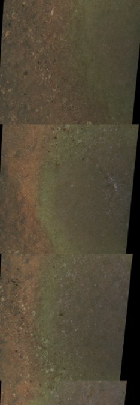
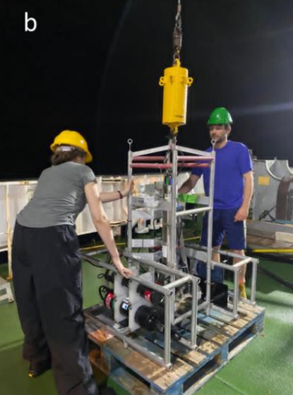

# Workshop

This page provides all the necessary setup instructions to help you make the most of the workshop. It also includes details about the dataset we will be using and the example notebooks that will guide our exercises.

## Coding environment

To ensure a smooth experience, we have set up a ready-to-use environment where all dependencies and example datasets are pre-installed. This means you won’t need to worry about installing anything manually—everything is configured and ready to go.

The environment is hosted on **notebook servers**, which are remote computing resources designed to facilitate interactive coding. These servers allow users to create, edit, and run Jupyter notebooks, which contain text, code, equations, and visualizations. Running code on a **remote notebook server** means computations will be performed on a powerful server rather than your local computer. This provides faster processing, access to specialized resources, and the flexibility to work from anywhere with an internet connection.

For this workshop, we will be using two remote services:

- [**NOC's Data Science Platform (DSP)**](DSP.md) – for NOC staff
- [**JASMIN**](jasmin.md) – for external users

## Datasets

### Greater Haig Fras seafloor imagery

- **Used in:** Tutorial 1
- **Collection:** Greater Haig Fras, UK (2012)
- **Equipment:** NOC AUV6000 camera system on the Autosub6000 autonomous underwater vehicle
- **Metadata:** iFDO

Autosub6000 photographed the seabed during mission 58 of RRS *Discovery* cruises 377/8. The workshop set contains 99 mosaicked image tiles from four survey lines; each tile combines five consecutive photographs.

The survey was the first in a series conducted while Greater Haig Fras was under consideration for Marine Conservation Zone status. It formed part of the Defra-funded project *Investigating the feasibility of utilizing AUV and Glider technology for mapping and monitoring of the UK MPA network (MB0118)*.

Sources: [BODC survey imagery](https://doi.org/10.5285/090239b1-b7dd-1030-e063-6c86abc-0e183), [Benoist et al. (2023), companion mosaicked image tiles](https://doi.org/10.5285/093edbc7-3552-3d35-e063-6c86abc099d5), [Ruhl (2013), cruise report](https://nora.nerc.ac.uk/id/eprint/500784/1/NOC_CR_23.pdf), and [Wynn et al. (2012), Defra project MB0118 final report](https://nora.nerc.ac.uk/id/eprint/500733/1/DEFRA_MB0118%28Wynn%29_FINAL.pdf).

### DY157 plankton imagery

- **Used in:** Tutorial 3
- **Collection:** DY157 RRS *Discovery* cruise (2023)
- **Equipment:** Red camera frame deployed vertically by winch
- **Metadata:** CSV

The camera recorded pelagic plankton in the water column. The exercises focus on uneven illumination and low contrast, both of which can make faint structures difficult to see.

Sources: [DY157 cruise inventory](https://www.bodc.ac.uk/resources/inventories/cruise_inventory/report/18120/), [Paidiverpy example datasets](https://paidiverpy.readthedocs.io/en/latest/example_data.html).

### JNCC East of Haig Fras seabed imagery

- **Used in:** Tutorials 2 and 4
- **Collection:** East of Haig Fras Marine Conservation Zone, UK (2013)
- **Equipment:** Canon PowerShot G5 on a drop-camera system aboard RV *Cefas Endeavour*
- **Metadata:** iFDO

The workshop uses 374 seabed photographs collected at 19 stations during the CEND0513 survey by the Joint Nature Conservation Committee (JNCC) and Cefas. This is a separate collection from the 2012 Greater Haig Fras survey. Tutorial 4 opens five images from the set for its custom and library algorithm exercises.

Sources: [JNCC image collection](https://jncc.resourcespace.com/pages/search.php?search=%21collection99) and [CEND0513 survey report](https://data.jncc.gov.uk/data/a74dc2aa-e8e9-4f23-81a2-287eefa7a47d/JNCC-CEFAS-28-FINAL-WEB.pdf). The images are credited to JNCC and Cefas and licensed under the [Open Government Licence v3.0](https://www.nationalarchives.gov.uk/doc/open-government-licence/version/3/).

## Tutorials

| Tutorial | What you will do |
| --- | --- |
| [1. Introduction](https://github.com/paidiver/paidiver-workshop/blob/main/tutorials/1-introduction.ipynb) | Run a small Haig Fras pipeline and compare the opened, grayscale, and smoothed images. |
| [2. Benthic imagery](https://github.com/paidiver/paidiver-workshop/blob/main/tutorials/2-benthic.ipynb) | Read the JNCC iFDO metadata, select an acquisition interval, and evaluate contrast, sharpening, and cropping. |
| [3. Pelagic imagery](https://github.com/paidiver/paidiver-workshop/blob/main/tutorials/3-pelagic.ipynb) | Compare illumination correction, local contrast, and gentle smoothing on plankton images. |
| [4. Custom and library algorithms](https://github.com/paidiver/paidiver-workshop/blob/main/tutorials/4-custom-and-library.ipynb) | Run a Python intensity inversion and an OpenCV median filter on a benthic dataset, then compare the same image across steps. |

These example datasets provide a foundation for users to explore the functionalities of the Paidiverpy package and conduct their analyses effectively.
