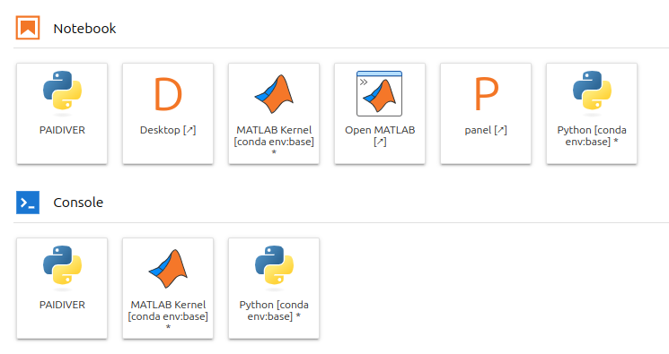
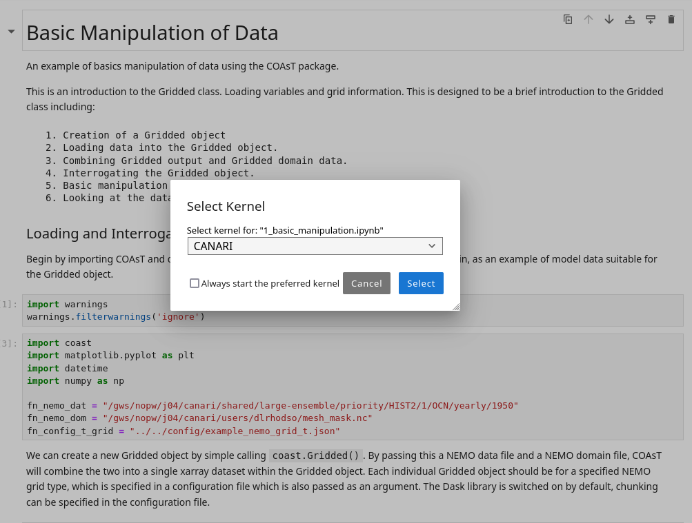

# JASMIN Documentation

### Logging into the JASMIN

To access the JASMIN environment, follow these steps:

1. In your web browser visit [https://notebooks.jasmin.ac.uk](https://notebooks.jasmin.ac.uk)
2. Login using your JASMIN username and password
3. You will then be emailed a one time code, paste this into the verification code box.
4. A Jupyter notebook interface will now be started and you can create a new notebook or open a terminal.

Your JASMIN home directory and group workspaces will be accessible from within the notebook environment.

---

### Setting up the PAIDIVERPY Conda Environment

A preconfigured PAIDIVERPY Conda environment is available for use. This environment includes all necessary packages and dependencies and is built using the `environment.yml` file from the [Paidiverpy GitHub repository](https://github.com/paidiver/paidiverpy/blob/main/environment.yml).

Since the environment is stored in a non-standard location (`/work/scratch-nopw2/tobfer/paidiver`), Jupyter will not detect it automatically. Follow these steps to set it up:

#### 1. Open a Terminal

From the Jupyter launcher, click the **Terminal** icon.

#### 2. Register the PAIDIVER Kernel

Run the following command:

```bash
mamba run -p /work/scratch-nopw2/tobfer/paidiver python -m ipykernel install --user --name Paidiver
```

#### 3. Troubleshooting

If the command above fails, try running these commands first, then repeat step 2:

```bash
mamba init
exec bash
```

#### 4. Download the example data

Run the commands below:

```bash
cd
micromamba activate /groups/paidiver/paidiver-env
wget https://paidiver-o.s3-ext.jc.rl.ac.uk/paidiverpy/tutorials.zip
unzip tutorials.zip -d paidiver/
```
Then check if the tutorials are available by running:

```bash
ls paidiver/tutorials
```


You should see as output:

```output
1-introduction.ipynb  2-benthic.ipynb  3-pelagic.ipynb  4-custom-and-library.ipynb  config  custom_algorithm  images  metadata
```

#### 5. Launch Jupyter with the Paidiver Environment

- Open a new Jupyter launcher by clicking **File** > **New Launcher**.
- A new notebook and console option named **Paidiver** should now be available (this may take about a minute to appear):



- Click on **Paidiver** to open a notebook.

#### 6. Verify the Installation

Run the following command in the first cell:

```python
import paidiverpy
paidiverpy.__version__
```

The expected version is `0.4.2`.

If this import fails, check that you selected the **Paidiver** kernel.

---

### Running an Example Notebook

1. Open the `paidiver-workshop` folder containing the cloned repository.
2. Navigate to the `tutorials` folder.
3. Open the `introduction.ipynb` notebook.
4. If prompted to select a kernel, choose **PAIDIVER**.

   

You are now ready to start working with PAIDIVERPY in JASMIN!
